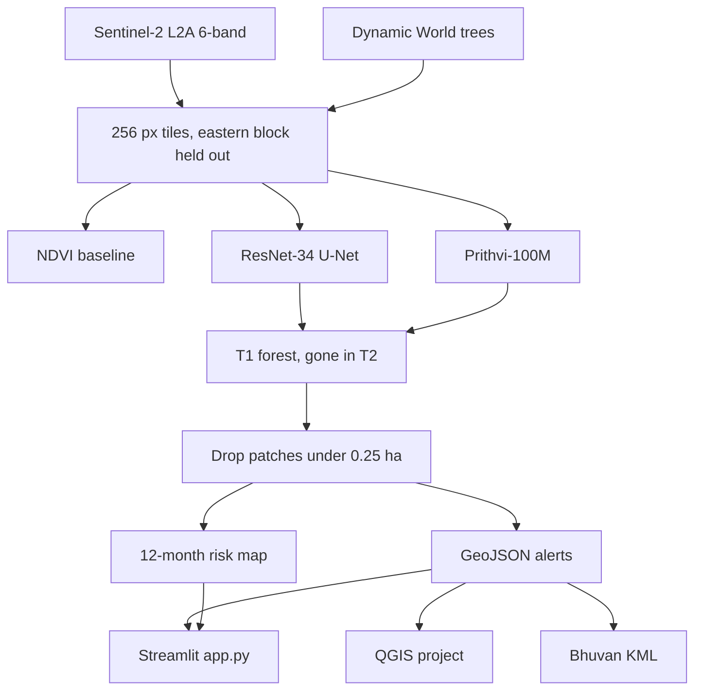

# VANASPATI-AI

Forest change detection from Sentinel-2, plus a 12-month clearing-risk map. The web app is a Streamlit map workstation. Hasdeo Arand (Chhattisgarh) is the site with a full trained pipeline; other landscapes are watch windows on live satellite layers.

## What it does

Most forest products only show loss after it has already happened. This repo splits the work in two:

1. **Detection.** Six-band Sentinel-2 L2A (`B2, B3, B4, B8, B11, B12`) goes through an NDVI baseline, a ResNet-34 U-Net, and NASA/IBM Prithvi-100M. Tiny blobs under 0.25 ha are dropped. Surviving patches become GeoJSON alerts.
2. **Risk.** Distance to recent clearings and haul roads, plus canopy-edge features, feed a small conv net that paints a 12-month vulnerability map (imminent / high / moderate / low).
3. **Delivery.** Streamlit map (before/after swipe, hover readout), a QGIS project, and an ISRO Bhuvan KML.

Held-out test tiles sit on a separate eastern block so train and test do not overlap in space.

## App features

- Split swipe between Esri archive and current imagery
- Hover readout: canopy %, NDVI, land cover, distance to clearing, SWIR, 6-band response
- Extra layers: Sentinel-2 cloudless (2018–2024), VIIRS, MODIS 7-2-1, HLS, IMERG rain, Sentinel-1 OPERA SAR
- Indian sites: Hasdeo, Saranda, Sundarbans, Kaziranga, Western Ghats, Silent Valley, Satpura, Tadoba, Namdapha (plus Sumatra and Amazon)
- Monsoon tab: Open-Meteo rainfall and NASA GIBS snapshots (optical vs SAR). This does **not** rewrite the deforestation alerts
- GeoJSON / KML downloads from the map HUD and from the QGIS / Bhuvan tab

## Held-out scores (eastern block)

| Model | Inputs | IoU | F1 | Precision | Recall |
| --- | --- | ---: | ---: | ---: | ---: |
| NDVI baseline | B4, B8 | 1.0000 | 1.0000 | 1.0000 | 1.0000 |
| ResNet-34 U-Net | 6 bands | 0.9832 | 0.9915 | 0.9884 | 0.9946 |
| Prithvi-100M | 6 bands | 0.9845 | 0.9922 | 0.9892 | 0.9951 |

## 12-month risk (Hasdeo window)

| Tier | P(loss) | Area |
| --- | --- | ---: |
| Imminent | > 80% | 0.00 ha |
| High | 50–80% | 100.73 ha |
| Moderate | 20–50% | 10,285.52 ha |
| Low | < 20% | 0.00 ha |

## Pipeline



## Run the app

Port 8501 is often taken by something else on this machine. Use 8502.

```powershell
cd deforestation-detection
python -m venv .venv
.\.venv\Scripts\Activate.ps1
pip install -r requirements.txt
python -m streamlit run app.py --server.port 8502
```

Then open http://127.0.0.1:8502

On macOS/Linux:

```bash
python -m venv .venv
source .venv/bin/activate
pip install -r requirements.txt
python -m streamlit run app.py --server.port 8502
```

Optional training/export:

```bash
python scripts/run_pipeline.py --region hasdeo_arand_india --force-data --epochs 3 --batch-size 4
```

The Streamlit process listens on `127.0.0.1` only. There is also a read-only stdio tool server (`python -m src.mcp_server`) if you want to query landscapes and alerts from an MCP client. It does not write files or open the app to the network.

## QGIS and Bhuvan

- `qgis/hasdeo_arand_monitoring.qgs` — UTM 44N / WGS84, CIR 8-4-3, alerts coloured by size
- `qgis/isro_deforestation_detector.py` — Processing Toolbox script
- `results/isro_bhuvan_deforestation_alerts.kml` — polygons with area, carbon, UTM

## Layout

```text
app.py                      Streamlit UI
scripts/run_pipeline.py     train / export
qgis/                       QGIS project + processing script
src/data/                   download, tiling, datasets
src/models/                 U-Net, Prithvi, risk net
src/postprocessing/         change polygons, Bhuvan KML
src/visualization/          map HUD, hotspots, monsoon panel
src/mcp_server.py           read-only MCP tools
results/                    GeoJSON, KML, figures, HTML maps
```

## Next

Offline MBTiles for field use, drone orthomosaics, and SAR-based change (not just a monsoon overlay) are still open.

## License

[MIT](LICENSE)
